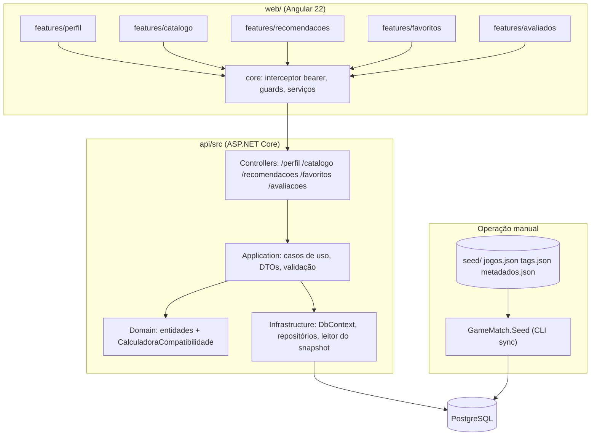
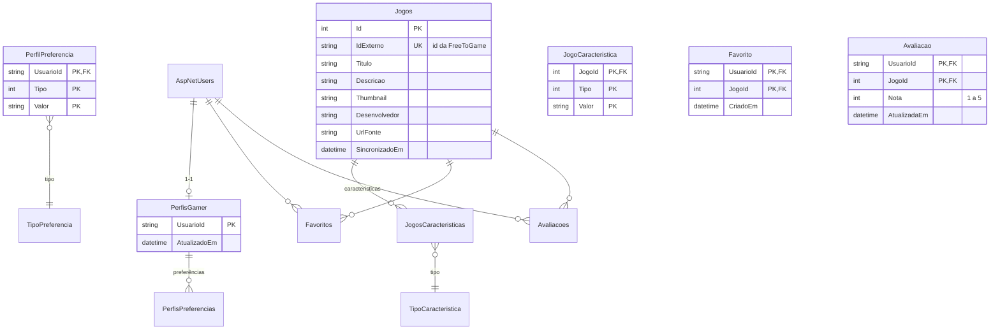
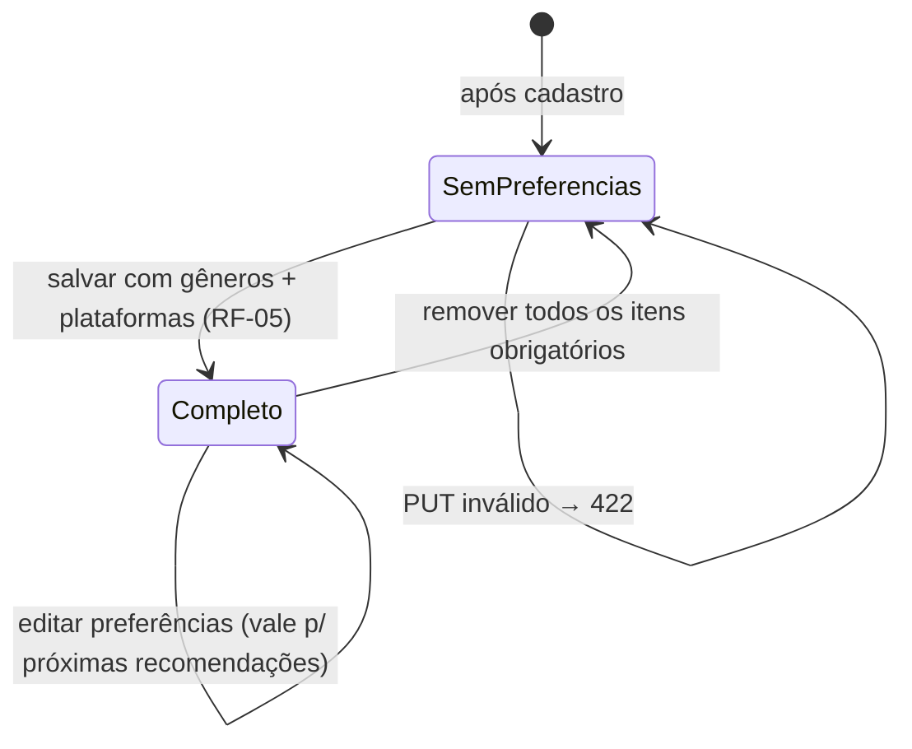
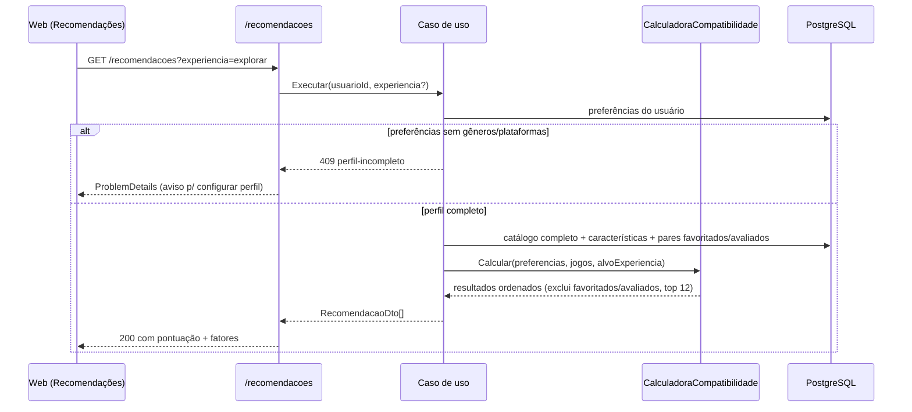

# TDD — GameMatch

| Campo | Valor |
|---|---|
| Produto | GameMatch — plataforma de descoberta e recomendação de jogos gratuitos |
| Status | Rascunho |
| Data | 2026-11-12 |
| Escopo | Design técnico das funcionalidades do MVP do PRD: perfil gamer, catálogo, recomendações, Modo Descoberta, favoritos e avaliações |
| Autores/decisores | Engenharia (este documento), com decisões coletadas ao solicitante por sistema de questões (§3) |
| Fontes | [`README.md`](../README.md), [`docs/prd.md`](prd.md), [`docs/arquitetura.md`](arquitetura.md), [`seed/README.md`](../seed/README.md), `AGENTS.md` |
| Divergências | Nenhuma entre PRD e TDD. O PRD marcou Q1 (fórmula), Q3 (opções do Modo Descoberta) e Q8 (sincronização) como pendentes — este TDD fecha essas decisões (DT-07, DT-08, DT-11) |

---

## 1. Resumo e objetivos técnicos

O GameMatch precisa de: (a) persistência do perfil gamer e das preferências,
(b) catálogo sincronizado da FreeToGame com pesquisa/filtros, (c) um motor de
recomendação explicável em memória, (d) favoritos e avaliações por usuário, e
(e) um Modo Descoberta que cruza uma experiência escolhida com o perfil.

**Restrições confirmadas** (fatos do projeto, não escolhas desta conversa):

- Fundação existente: .NET 10 + ASP.NET Core (controllers), EF Core +
  Npgsql + PostgreSQL em Docker, Angular 22 zoneless/signals, Tailwind,
  xUnit, JWT com chave obrigatória, ProblemDetails, `/health` (PRD P-1,
  `docs/arquitetura.md`).
- Camadas: `Domain` (regras puras, inclui a calculadora de compatibilidade),
  `Application` (casos de uso/DTOs), `Infrastructure` (EF Core, repositórios,
  clientes externos), `Api` (controllers, composição).
- Catálogo via **snapshot local** em `seed/` (`jogos.json`, `tags.json`,
  `metadados.json`); atribuição FreeToGame no rodapé é exigência dos termos.
- Projeto acadêmico, entrega funcional prevista até novembro/2026 (PRD R-4).
- Sem CI no repositório (fato verificado: não há `.github/`).

**Atributos de qualidade relevantes:** explicabilidade da recomendação
(PR O-2), consistência sempre atual (perfil é fonte única), testabilidade do
motor de recomendação em isolamento, navegação sem quebra com API
indisponível (RNF-05).

**Fora de escopo deste TDD:** histórico de atividade, exclusão de conta,
perfil público, integração em tempo real com a FreeToGame, CI/CD, telemetria
(PRD §5.2–5.3).

## 2. Decisões técnicas centralizadas

Legenda de estado: **existente** = já está no projeto; **confirmada** =
decidida nesta entrevista com o solicitante; **proposta** = detalhe de design
deste documento, revogável na revisão.

| ID | Tema | Decisão | Estado | Origem/decisor | Justificativa | Alternativas descartadas | Consequência |
|---|---|---|---|---|---|---|---|
| DT-01 | Linguagem/runtime backend | C# / .NET 10, ASP.NET Core com controllers | existente | Fundação (`docs/arquitetura.md`) | Contrato HTTP explícito; já implementado | Minimal APIs | — |
| DT-02 | Persistência | EF Core + Npgsql, PostgreSQL em Docker, migrations | existente | Fundação | Pipeline já reproduzível | — | — |
| DT-03 | Identidade | ASP.NET Core Identity + JWT (chave ≥32 chars, não versionada) | existente | Fundação (`README.md`) | Conta/login já implementados | — | Todos os novos endpoints autenticados usam o mesmo bearer token |
| DT-04 | Frontend | Angular 22 zoneless, standalone + signals, Tailwind, rotas lazy por feature | existente | Fundação | Já adotado; estado simples sem NgRx | NgRx | Novas features seguem `features/<nome>/` |
| DT-05 | Convenção de API | Rotas em português **sem versionamento**, erros ProblemDetails com `traceId` | confirmada | Entrevista (solicitante) | Consistência com `/contas`, `/conta`, `/health` | Versionar `/v1` a partir dos novos endpoints | Superfície de API homogênea; versionamento futuro exigirá migração |
| DT-06 | Modelo de preferências | Listas **normalizadas**: tabelas de entidade fraca `(PerfilId, Tipo, Valor)` com unicidade composta | confirmada | Entrevista (solicitante) | Consultáveis e integros; evita JSONB opaco | JSONB no Postgres | Mais tabelas, mas consultas de cálculo/filtro simples |
| DT-07 | Fórmula de compatibilidade | Pesos fixos: **gêneros 40%, plataformas 20%, estilos 25%, experiência 15%**; fator = sobreposição (interseção ÷ nº de itens do usuário); fator sem dados do usuário é ignorado e os pesos são **renormalizados** proporcionalmente; resultado 0–100 arredondado para inteiro | confirmada | Entrevista (solicitante), fecha PRD Q1 | Simples, explicável, testável; pesos fixos cabem no prazo acadêmico | Pesos iguais; pesos configuráveis em `appsettings` | Ajuste de pesos exige nova versão (mitigação: constantes centrais em `Domain`) |
| DT-08 | Origem de estilos/experiência | Estilos do perfil = **tags** do snapshot (`tags.json`); "preferências de experiência" do perfil e opções do Modo Descoberta = subconjunto de opções fixas mapeadas para gêneros/tags | confirmada | Entrevista (solicitante), fecha PRD Q3 | FreeToGame não expõe estilos/experiência; tags são a fonte prevista no seed | Catálogo curado próprio; texto livre | Mapeamento opção→gêneros/tags vive em configuração (ver DT-09) |
| DT-09 | Opções do Modo Descoberta | Lista fixa proposta: **Relaxar, Competir, Explorar, Cooperar, História/imersão** — cada uma com mapeamento para gêneros/tags em `appsettings` (`Descoberta:Opcoes`) | confirmada (proposta técnica, ajustável por produto) | Entrevista (solicitante); conteúdo do mapeamento é proposta deste TDD | Fecha PRD Q3 com 5 opções objetivas; configurável sem recompilar | Derivar das tags mais frequentes; deixar A definir | Produto pode revisar rótulos/mapeamentos sem mudança de código |
| DT-10 | Produção de recomendações | Cálculo **sob demanda em memória**, sem persistência da entidade Recomendação | confirmada | Entrevista (solicitante) | Perfil é fonte única; catálogo local é pequeno; elimina invalidação | Persistir e recalcular | Recomputo a cada chamada — aceitável (ver DT-14) |
| DT-11 | Sincronização do snapshot | **Comando CLI manual** (`dotnet run --project api/src/GameMatch.Seed -- sync`), upsert no banco a partir de `seed/*.json`; a API apenas lê | confirmada | Entrevista (solicitante), fecha PRD Q8 | Simples, offline, reproduzível; alinhado ao propósito acadêmico | Endpoint administrativo; auto-load na inicialização | Atualização do catálogo é operação manual documentada em `docs/ambiente.md` |
| DT-12 | Exclusão nas recomendações | Jogos **já favoritados ou avaliados** pelo usuário são excluídos das recomendações (continuam no catálogo) | confirmada | Entrevista (solicitante) | Evita sugestões repetidas | Não excluir; excluir só avaliados | Recomendações podem reduzir de tamanho para perfis ativos |
| DT-13 | Exposição do Modo Descoberta | **Mesmo endpoint** `GET /recomendacoes` com parâmetro opcional `experiencia` | confirmada | Entrevista (solicitante) | Menos superfície de API; mesmo caso de uso | Endpoint próprio `/recomendacoes/descoberta` | Contrato único a testar |
| DT-14 | Paginação/limites | Catálogo paginado (padrão 24/página, `pagina`+`tamanho`, teto 100); recomendações retornam **top 12** ordenadas; valores em configuração | confirmada | Entrevista (solicitante) | Previsível para a UI e para o orçamento de CPU | Listas completas; cursor/offset | Cálculo percorre o catálogo inteiro em memória (O(N)) — ok para o volume do snapshot |
| DT-15 | Modelagem do catálogo | Entidade `Jogo` com características normalizadas `(JogoId, Tipo, Valor)` para gêneros, plataformas e tags, espelhando o modelo do perfil (DT-06) | proposta | Este TDD | Simetria com o perfil simplifica cálculo e filtros | Colunas separadas `int[]`/JSONB | Duas tabelas de atributos no schema |
| DT-16 | Testes | Suítes **locais**: xUnit (unit + integração com Postgres do compose) e runner do Angular; **sem CI** no âmbito deste TDD | confirmada | Entrevista (solicitante) | Sem `.github/` hoje; Docker já é pré-requisito | GitHub Actions agora; SQLite nas integrações | CI fica como pendência (P-06) |
| DT-17 | Motor de recomendação em `Domain` | Calculadora pura em `GameMatch.Domain` (sem EF/HTTP), recebendo preferências e características como entradas | existente (previsto) + proposta | `docs/arquitetura.md` prevê a calculadora no `Domain` | Testável em unit test puro; regra pura conforme a tabela de camadas | Cálculo no `Infrastructure`/handler | `Application` orquestra: carrega dados → chama `Domain` → projeta DTO |

## 3. Arquitetura e estrutura

### 3.1 Componentes e fronteiras



**Responsabilidades:**

- **`Domain`**: entidades (`PerfilGamer`, `Jogo`, `Favorito`, `Avaliação`),
  objetos de valor e a `CalculadoraCompatibilidade` (regra pura, DT-17).
- **`Application`**: casos de uso (salvar perfil, listar catálogo com
  filtros, gerar top-12, favoritar/avaliar), DTOs de entrada/saída e
  validação (ex.: nota 1–5, campos obrigatórios do perfil).
- **`Infrastructure`**: mapeamentos EF Core, repositórios, leitura dos
  arquivos do snapshot (no projeto de CLI), índices.
- **`Api`**: controllers com autorização JWT, ProblemDetails, Swagger.
- **`GameMatch.Seed`** (novo, fase F2): executável console que popula o
  banco a partir de `seed/` (DT-11); reutiliza o `Infrastructure`.
- **Frontend**: novas pastas em `web/src/app/features/` seguindo o padrão
  `core/`, `shared/`, `layout/` já estabelecido; rotas lazy.

Por que esse recorte atende ao escopo: preserva a regra de dependência da
fundação, isola o algoritmo (o item de maior risco acadêmico) em teste puro e
permite entregar por fases (§7) sem retrabalho.

## 4. Dados e persistência

### 4.1 Diagrama entidade-relação



*(Os enums `TipoPreferencia`/`TipoCaracteristica` assumem os mesmos valores:
`Genero = 1`, `Plataforma = 2`, `Estilo = 3`, `Experiencia = 4` — o perfil
usa os quatro; o jogo usa os três primeiros.)*

### 4.2 Invariantes

| ID | Invariante | Enforce |
|---|---|---|
| INV-01 | `PerfilPreferencia` única por `(UsuarioId, Tipo, Valor)` | PK composta (EF) |
| INV-02 | Perfil com `Genero` e `Plataforma` presentes é a única condição para liberar recomendações (PRD RB-06/RB-07) | Caso de uso valida antes de gerar; API retorna `409` com código `perfil-incompleto` |
| INV-03 | `Jogo.IdExterno` único — sincronização é upsert, nunca duplica | Índice único |
| INV-04 | `Avaliacao.Nota ∈ [1,5]` | CHECK no banco + validação no DTO |
| INV-05 | Um `Favorito` e uma `Avaliação` por par `(UsuarioId, JogoId)` | PK composta; POST repetido = idempotente (200) ou `409` conforme contrato (§5) |
| INV-06 | Recomendações excluem pares já favoritados/avaliados (DT-12) | Filtro no caso de uso |
| INV-07 | Usuário só acessa próprio perfil, favoritos e avaliações | `UsuarioId` sempre derivado do token, nunca do corpo |

### 4.3 Índices e consultas

- `JogosCaracteristicas (Tipo, Valor)` — filtros de catálogo por
  gênero/plataforma/tag e busca por nome via `ILIKE` em `Jogos.Titulo`
  (volume pequeno; sem full-text search no MVP).
- `Favoritos (UsuarioId)`, `Avaliacoes (UsuarioId)` — listas por usuário e
  exclusão nas recomendações (INV-06).
- Recomendação: carrega preferências do usuário + catálogo completo com
  características (duas leituras em lote), calcula em memória (DT-10/DT-14).
  Não há cache no MVP (pendência P-05).

### 4.4 Migrações e recuperação

- Migrations EF por fase (§7), nomeadas na convenção existente; nunca editar
  migration já aplicada.
- Snapshot versionado no repositório é a fonte do catálogo; recuperação do
  banco = `dotnet ef database update` + `GameMatch.Seed sync` (procedimento
  em `docs/ambiente.md`).
- Backup/recuperação de dados de usuários em produção: **não se aplica no
  MVP acadêmico** (premissa P-2 do PRD).

### 4.5 Ciclo de vida do perfil (estados)



## 5. Interfaces e integrações

> Contratos **propostos** por este TDD, seguindo DT-05 (rotas em português,
> sem versão, ProblemDetails). Ressalvas na revisão alteram este §5.

### 5.1 Endpoints novos

Todos exigem `Authorization: Bearer <token>` (DT-03) exceto onde indicado.

| Método | Rota | Req (PRD) | Entrada | Saída | Erros |
|---|---|---|---|---|---|
| `GET` | `/perfil` | RF-05 | — | `PerfilDto` (generos, plataformas, estilos, experiências) | 401 |
| `PUT` | `/perfil` | RF-05 | `PerfilSalvarDto` (obrigatório: `generos[]`, `plataformas[]`; opcionais: `estilos[]`, `experiencias[]`) | `PerfilDto` | 401, 422 (validação) |
| `GET` | `/catalogo?pagina=1&tamanho=24&busca=&genero=&plataforma=&tag=` | RF-07/08 | query strings combináveis (RB-09) | `PaginaDto<JogoResumoDto>` (`items`, `pagina`, `tamanho`, `total`) | 401, 400 (parâmetros inválidos) |
| `GET` | `/catalogo/filtros` | RF-08 | — | listas de gêneros, plataformas e tags existentes no catálogo | 401 |
| `GET` | `/catalogo/{id}` | RF-07 | id interno | `JogoDetalheDto` (com características e `urlFonte`) | 401, 404 |
| `GET` | `/recomendacoes?experiencia=` | RF-10..15 | `experiencia` opcional = uma das chaves de DT-09 | `{ itens: [RecomendacaoDto] }` — top 12 (DT-14) | 401, **409 `perfil-incompleto`** (CA-13), 404 se `experiencia` desconhecida |
| `GET` | `/recomendacoes/opcoes` | RF-14 | — | opções do Modo Descoberta (chave + rótulo, de `Descoberta:Opcoes`) | 401 |
| `GET` | `/favoritos?tamanho=&pagina=` | RF-18 | paginação opcional | `PaginaDto<JogoResumoDto>` | 401 |
| `POST` | `/favoritos/{jogoId}` | RF-16 | id do jogo | 201 na criação; **200 idempotente** se já existir (INV-05) | 401, 404 (jogo inexistente) |
| `DELETE` | `/favoritos/{jogoId}` | RF-16 | id do jogo | 204 | 401, 404 |
| `GET` | `/avaliacoes/{jogoId}` | RF-17 | id do jogo | `AvaliacaoDto` ou 404 | 401 |
| `PUT` | `/avaliacoes/{jogoId}` | RF-17 | `{ nota: 1..5 }` | `AvaliacaoDto` (cria ou substitui — RB-15) | 401, 422 (nota fora de 1–5), 404 |
| `DELETE` | `/avaliacoes/{jogoId}` | RF-17 | id do jogo | 204 | 401, 404 |

**`RecomendacaoDto`** (fecha RF-10 + RF-11 + CA-11/CA-12):

```json
{
  "jogo": { "id": 12, "titulo": "...", "thumbnail": "...", "generos": [], "plataformas": [] },
  "pontuacao": 87,
  "fatores": [
    { "chave": "generos", "rotulo": "Gêneros", "contribuicao": 16,
      "correspondencias": ["RPG", "Ação"] },
    { "chave": "plataformas", "rotulo": "Plataformas", "contribuicao": 20,
      "correspondencias": ["PC"] },
    { "chave": "estilos", "rotulo": "Estilos de gameplay", "contribuicao": 25,
      "correspondencias": ["turn-based", "fantasy"] },
    { "chave": "experiencia", "rotulo": "Experiência", "contribuicao": 26,
      "correspondencias": ["exploração", "mundo aberto"] }
  ]
}
```

`contribuicao` = `round(peso × fator × 100)` após renormalização; a soma das
contribuições = `pontuacao` (±1 por arredondamento — documentado em teste).

### 5.2 Motor de compatibilidade (DT-07)

```
pontuacao = round( 0.40·G + 0.20·P + 0.25·E + 0.15·X ) × 100
G = |generos_perfil ∩ generos_jogo|   ÷ |generos_perfil|
P = |plataformas_perfil ∩ plataformas_jogo| ÷ |plataformas_perfil|
E = |estilos_perfil ∩ tags_jogo|     ÷ |estilos_perfil|      (0 se vazio → ignora e renormaliza)
X = no modo padrão: |experiencias_perfil ∩ mapeamento_jogo| ÷ |experiencias_perfil|
    no Modo Descoberta: |alvo_opcao ∩ mapeamento_jogo| ÷ |alvo_opcao|   (DT-08/DT-09)
    onde mapeamento_jogo = generos_jogo ∪ tags_jogo
```

- Pesos renormalizados proporcionalmente entre os fatores **definidos**
  (G e P sempre definidos — INV-02).
- Sem correspondências em nenhum fator → `pontuacao = 0` (o jogo não entra
  no top 12, salvo catálogo insuficiente — comportamento: retorna o que houver).
- A calculadora recebe `Preferencias` + `Caracteristicas` + `PesoExperiencia`
  opcional e devolve `Resultado { Pontuacao, Fatores[] }` — pura, sem
  I/O (DT-17).

### 5.3 Sequência — gerar recomendações



Falhas: API indisponível → interceptor trata, shell sinaliza status
indisponível sem quebrar navegação (RNF-05, comportamento já previsto).

### 5.4 Integração com o snapshot (DT-11)

- `GameMatch.Seed sync`: lê `seed/jogos.json`, `seed/tags.json`,
  `seed/metadados.json`; faz **upsert** por `IdExterno` (INV-03); substitui
  características por transação; imprime resumo (inseridos/atualizados) e
  data de coleta.
- Os arquivos são somente leitura para a aplicação (regra do `seed/README.md`);
  a aplicação nunca escreve em `seed/`.
- Falha de formato do JSON → aborta com mensagem clara e **não** altera o
  banco (transação única).

### 5.5 Frontend — rotas novas

| Rota | Guard | Feature |
|---|---|---|
| `/perfil` | autenticado | `features/perfil` |
| `/catalogo` | autenticado | `features/catalogo` (pesquisa + filtros + estado vazio CA-10) |
| `/recomendacoes` | autenticado | `features/recomendacoes` (inclui Modo Descoberta, CA-14/15) |
| `/favoritos` | autenticado | `features/favoritos` |

- Serviços em `core/servicos` compartilham o interceptor bearer existente.
- Estados de erro/ausência: aviso `perfil-incompleto` (CTA p/ `/perfil`),
  estado vazio de catálogo, status de API indisponível no shell.

## 6. Segurança e operação

| Área | Definido neste TDD | A definir |
|---|---|---|
| Autenticação/Autorização | JWT existente; todos os novos endpoints `[Authorize]`; `UsuarioId` sempre do token (INV-07) | — |
| Segredos | Chave JWT via user-secrets/`Jwt__Chave`; nada sensível versionado (já praticado) | — |
| Validação | DTOs validados (obrigatórios do perfil, nota 1–5, parâmetros de página) → 422/400 ProblemDetails | — |
| Injeção | EF Core parametrizado; sem SQL bruto | — |
| Dados pessoais | Perfil/favoritos/avaliações privados (RNF-02); sem perfil público | Retenção/exclusão pós-MVP (PRD Q6) |
| Rate limiting / brute force | — | Não contemplado no MVP; revisar pós-MVP (P-06) |
| Observabilidade | `/health` existente; logs de erro com `traceId` via ProblemDetails | Métricas/logs estruturados (PRD RNF-09) |
| Deploy/CI | Suítes locais como critério de entrega (DT-16); deploy = ambiente local/demonstração | GitHub Actions, pipeline de produção (P-06) |

## 7. Qualidade e verificação

### 7.1 Estratégia de testes (DT-16)

| Nível | Ferramenta | Cobre |
|---|---|---|
| Unitário (`GameMatch.UnitTests`) | xUnit | `CalculadoraCompatibilidade` (pesos, renormalização, 0–100, arredondamento), validações de DTO, regras de favorito/avaliação |
| Integração (`GameMatch.IntegrationTests`) | xUnit + Postgres do compose | endpoints novos, invariantes INV-01..07, sync do snapshot (fixture com JSON de exemplo) |
| Frontend | runner do Angular CLI | serviços, guards, componentes de perfil/catálogo/recomendações (estados vazio/erro/perfil-incompleto) |
| Contrato | asserts sobre DTOs/ProblemDetails nos testes de integração | §5.1 |
| Ponta a ponta | manual guiado pelas jornadas J-1..J-8 do PRD na revisão do MVP | Critérios CA-01..CA-20 |

### 7.2 Cenários específicos

- **Cálculo:** pesos renormalizados quando estilos/experiências vazios;
  fórmula manual conferida em teste (ex.: G=1, P=1, E=0.5, X=0.5 → 87);
  exclusão de favoritados/avaliados (DT-12).
- **Concorrência:** dois `PUT /avaliacoes` simultâneos → PK composta
  garante um registro; favoritar duplicado duas vezes → 200 idempotente.
  Teste de integração com chamadas paralelas.
- **Segurança:** chamada sem token → 401; usuário A não lê/escreve dados
  de B (INV-07); nota 0 ou 6 → 422.
- **Desempanho:** sem baseline (PRD Q5) — validar manualmente que top-12 e
  página de catálogo respondem de forma fluida no volume do snapshot;
  meta exata permanece `A definir`.
- **Acessibilidade:** navegação por teclado e labels nos fluxos novos
  (RNF-07); auditoria formal: `A definir`.

### 7.3 Critérios de aceite técnicos (rastreáveis)

| Critério | Requisitos | Verificação |
|---|---|---|
| TC-01 | RF-05/06, CA-06/07 | Integração: PUT inválido → 422; válido → 200; GET reflete dados |
| TC-02 | RF-07..09, CA-08..10 | Integração: filtros combinados, paginação, 404/estado vazio; UI com fixture |
| TC-03 | RF-10/12, CA-11 | Unit: fórmula e ordenação; Integração: 0≤pont≤100, top-12 ordenado |
| TC-04 | RF-11, CA-12 | Integração: soma das contribuições ≈ pontuação; fatores presentes |
| TC-05 | RF-13, CA-13 | Integração: 409 `perfil-incompleto` sem preferências; UI exibe CTA |
| TC-06 | RF-14/15, CA-14/15 | Integração: `experiencia` válida/inválida; UI do Modo Descoberta |
| TC-07 | RF-16..18, CA-16/17 | Integração: idempotência, nota 1–5, remoção, exclusão nas recomendações |
| TC-08 | RNF-01/03/04/08, CA-18..20 | Suítes verdes (`dotnet test`, `npm test`); rodapé com atribuição; chave JWT obrigatória |

## 8. Roadmap de implementação

Sem cronograma/datas (não confirmados); ordem por dependência. Marco **MVP**
= todas as fases concluídas com TC-01..TC-08 verdes.

| Fase | Escopo (PRD) | Pré-requisitos | Entregáveis | Critério de saída |
|---|---|---|---|---|
| **F1 — Perfil gamer** (P0) | RF-05, RF-06 (DT-06) | Fundação + contas existentes | Migrations das preferências; endpoints `GET/PUT /perfil`; UI `/perfil`; unit + integração | TC-01 verde; CA-06/07 manual |
| **F2 — Catálogo** (P0) | RF-07..09 (DT-11, DT-15) | Snapshot em `seed/` (D-1) | Projeto `GameMatch.Seed` + sync; entidade `Jogo`; endpoints `/catalogo*`; UI `/catalogo` com pesquisa, filtros e estado vazio | TC-02 verde; `sync` popula banco de forma idempotente |
| **F3 — Recomendações + Modo Descoberta** (P1) | RF-10..15 (DT-07..10, DT-12..14) | F1 e F2 | `CalculadoraCompatibilidade` no `Domain`; endpoints `/recomendacoes*`; UI `/recomendacoes` com explicação, CTA de perfil incompleto e seletor de experiência | TC-03..TC-06 verdes; CA-11..CA-15 manual |
| **F4 — Favoritos e avaliações** (P1) | RF-16..18 (DT-12) | F2 | Endpoints `/favoritos`, `/avaliacoes`; UI; ligação com exclusão nas recomendações | TC-07 verde; CA-16/17 manual |
| **F5 — Verificação do MVP** | RNF-03/05/07/08, CA-18..20 | F1..F4 | Revisão de acessibilidade básica, verificação do rodapé, suítes completas, atualização de `docs/ambiente.md` | TC-08 verde; checklist do PRD §5.1 aprovado → **marco MVP** |

- **Validações que bloqueiam fases:** conteúdo do snapshot (bloqueia F2 —
  D-1/R-2); revisão do mapeamento das opções do Modo Descoberta por produto
  (não bloqueia F3 — configurável via `Descoberta:Opcoes`, DT-09); fórmula
  aprovada nesta entrevista (DT-07 — desbloqueia F3; ajustes são
  constantes no `Domain`).
- **Rollout:** aplicação sequencial de migrations por fase; rollback =
  reverter para migration anterior + redeploy (ambiente local/demonstração;
  sem produção).
- **Pós-MVP:** histórico (PRD Q7), exclusão de conta (Q6), CI (P-06),
  cache de recomendações (P-05) — changes separados.

## 9. Riscos, alternativas e pendências

| ID | Item | Tipo | Mitigação/ação | Responsável | Condição de resolução |
|---|---|---|---|---|---|
| R-1 | Fórmula ainda não validada com dados reais (pesos podem produzir poucas recomendações) | Risco | Testes com cenários do snapshot real em F3; pesos centralizados | Engenharia | Ajuste de constantes sem mudança de arquitetura |
| R-2 | Snapshot incompleto/desatualizado | Risco | Validar `seed/` antes de F2 | Engenharia | `sync` roda e catálogo exibe jogos |
| R-4 | Janela acadêmica até novembro/2026 | Risco | Fases na ordem da §8; cortar evoluções pós-MVP antes do escopo | Produto + engenharia | MVP verificado (TC-01..08) |
| R-5 | Perfil mínimo frustra novos usuários | Risco | CTA claro em `/perfil` a partir do aviso 409 | Design | Revisão do fluxo em F3 |
| P-01 | Fundação técnica (API, banco, contas) | Premissa | — | — | — |
| P-02 | Projeto acadêmico, sem produção | Premissa | — | — | — |
| P-03 | Pesos 40/20/25/15 e lista de 5 opções | Decisão (DT-07/09) | Revisáveis na revisão do TDD | Solicitante | Aprovação deste documento |
| P-04 | Sem CI (DT-16) | Premissa | Suítes locais como gate | Engenharia | — |
| P-05 | Sem cache de recomendações | Limitação | Aceito (catálogo pequeno) | — | Reavaliar se o catálogo crescer |
| P-06 | Sem rate limiting, sem pipeline CI/CD | Pendência pós-MVP | Registrar em change posterior | Engenharia | Após MVP |
| Q-01 | Conteúdo/rotulagem final do Modo Descoberta (DT-09) | Pendência não bloqueante | `Descoberta:Opcoes` em configuração | Produto | Revisão de UI antes da entrega |
| Q-02 | Tempos de resposta esperados (PRD Q5) | A definir | Medir em F3 no ambiente local | Engenharia | Meta registrada no PRD |
| Q-03 | Metas de telemetria (PRD Q4) | A definir | Fora deste TDD | Produto | Change de observabilidade |

### Mapa de rastreabilidade (resumo)

| PRD | Decisões | Fases | Verificação |
|---|---|---|---|
| RF-01..04 (contas) | DT-03, DT-05 | já entregue | CA-01..05, CA-18 |
| RF-05/06 | DT-06 | F1 | TC-01 |
| RF-07..09 | DT-11, DT-15 | F2 | TC-02 |
| RF-10..13 | DT-07, DT-08, DT-10, DT-12, DT-14, DT-17 | F3 | TC-03..05 |
| RF-14/15 | DT-09, DT-13 | F3 | TC-06 |
| RF-16..18 | DT-12 | F4 | TC-07 |
| RNF-01..09 | DT-16, §6 | F5 + contínuo | TC-08 |

---

*Documento gerado pela skill `generate-tdd` a partir do `README.md` e
`docs/prd.md`, com decisões técnicas coletadas por sistema de questões junto
ao solicitante. Nenhuma implementação foi realizada neste fluxo.*
